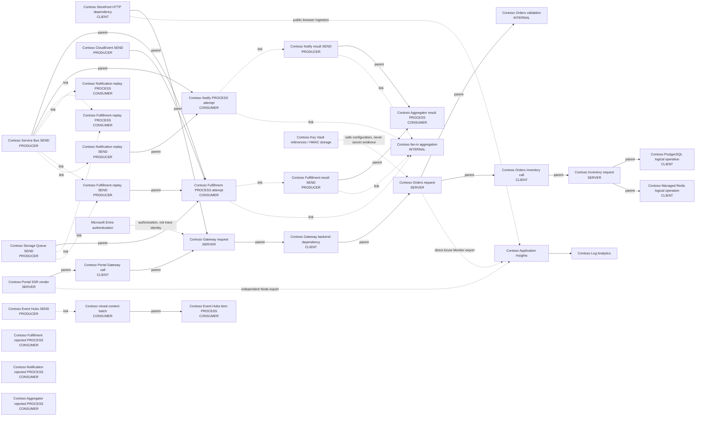

# Contoso correlation architecture

Generated from the single expected boundary map. This is the declared topology, not a claim of observed certification.

Solid edges are parent relationships; dotted edges are links or labelled non-causal configuration/export flows.
PostgreSQL and Redis nodes are CLIENT operations, not database server continuations.

## Declared new-root boundaries

- portal.request: A document render and browser page telemetry are distinct roots unless context is actually propagated.
- aggregator.fanin: Complete persisted contributors are links; arrival order never selects a parent.
- aggregator.batch: Mixed-message contexts are bounded links; the first message is never parent.
- fulfillment.result: The result SEND is a new root linked to the persisted actual Fulfillment PROCESS context.
- notify.result: The result SEND is a new root linked to the persisted actual Notification PROCESS context.
- fulfillment.replay.process: The actual Fulfillment identity processes its requested DLQ source as new work linked to the original context.
- notify.replay.process: The actual Notification identity processes its requested DLQ source as new work linked to the original context.
- fulfillment.replay.send: The owning Fulfillment outbox starts new SEND work linked to the original publication context, not an invented Orders actor.
- notify.replay.send: The owning Notification outbox starts new SEND work linked to the original publication context, not an invented Orders actor.

## Conditional A03 root candidates

These are not unconditional parent-edge exemptions. R7/R9 must verify a separately source-bound native trust-root receipt, actual null parent and real native IDs before accepting an edge break.
Policy deletion, a caller label, valid context with invalid state, or business-ID replacement is not such a receipt.

- gateway.request: absent, duplicate, invalid; native receipt required.
- orders.request: absent, invalid; native receipt required.
- inventory.request: absent, invalid; native receipt required.
- fulfillment.process: ABSENT, INVALID_CONTEXT; native receipt required.
- notify.process: ABSENT, INVALID_CONTEXT; native receipt required.
- aggregator.batch.item: ABSENT, INVALID_CONTEXT; native receipt required.
- fulfillment.rejected: UNTRUSTED_PUBLICATION, INVALID_ENVELOPE, INVALID_CARRIER, ENVELOPE_TOO_LARGE; native receipt required.
- notify.rejected: UNTRUSTED_PUBLICATION, INVALID_ENVELOPE, INVALID_CARRIER, ENVELOPE_TOO_LARGE; native receipt required.
- aggregator.rejected: UNTRUSTED_PUBLICATION, INVALID_CARRIER, INVALID_ENVELOPE, ENVELOPE_TOO_LARGE; native receipt required.

## Transport and trust limits

- Service Bus, Event Hubs, Event Grid, and Queue carry context; no invented broker spans.
- VNet-integrated workers use the selected authenticated TLS transport endpoints. Integration is not Private Link.
- PostgreSQL and Managed Redis private connectivity is independent of application ingress and SCM deployment.
- Result/outbox work retains real contributor contexts; fan-in and mixed batches have no arbitrary input parent.
- Browser telemetry is publicly injectable; controlled synthetic certification is not universal actor attestation.
- Complete sampled positive vectors and strict unsampled propagation are separate, mandatory assertions.
